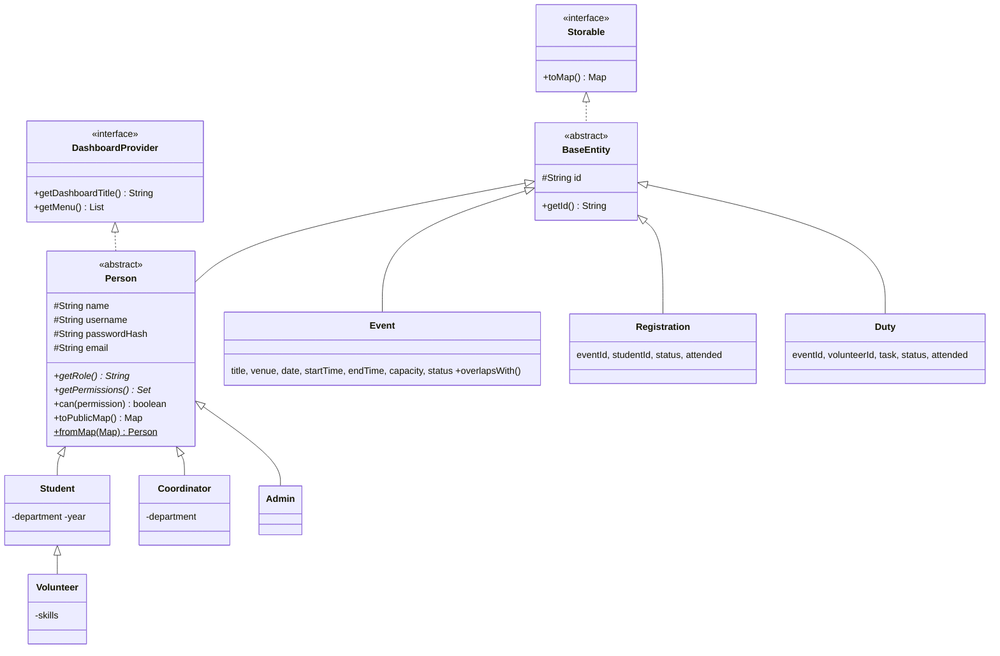
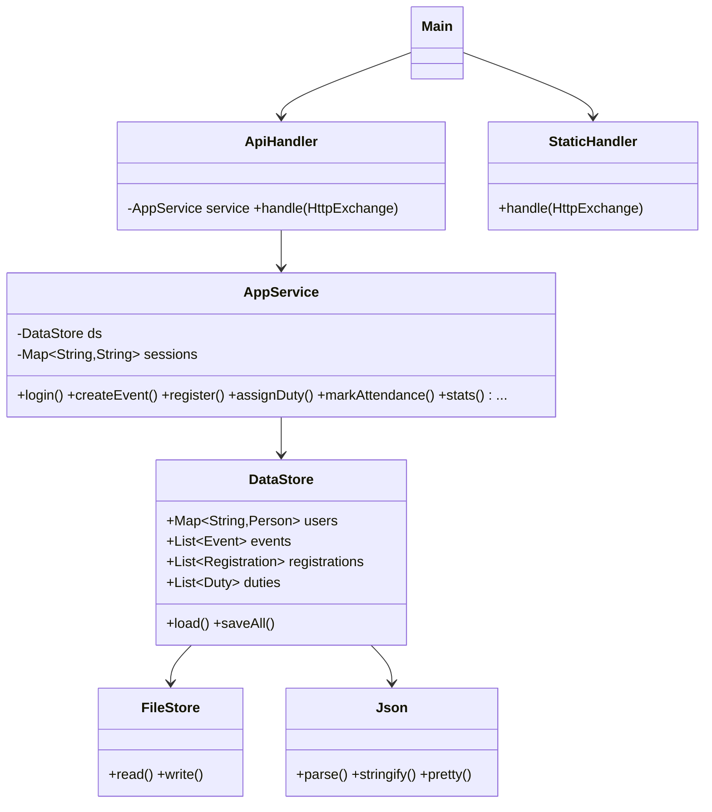

# Architecture

## 1. Big picture (3 layers)

```
   BROWSER (HTML + CSS + JavaScript)                    JAVA PROGRAM (java -cp out Main)
  ┌──────────────────────────────┐   HTTP + JSON   ┌─────────────────────────────────────────┐
  │ index.html  css/  js/app.js  │ ───────────────►│ server/  ApiHandler   (routes /api/*)    │
  │ login, dashboards, forms,    │                 │          StaticHandler (serves web/)     │
  │ buttons, tables              │ ◄───────────────│ ────────────────────────────────────────│
  └──────────────────────────────┘   JSON answer   │ service/ AppService  (rules, validation, │
                                                   │                       permissions)       │
                                                   │          DataStore   (ArrayList/HashMap) │
                                                   │ ────────────────────────────────────────│
                                                   │ model/   Person, Student, Volunteer,     │
                                                   │          Coordinator, Admin, Event, ...  │
                                                   └───────────────┬─────────────────────────┘
                                                                   │ util/FileStore + Json
                                                          ┌────────▼─────────┐
                                                          │ data/*.json files │
                                                          └──────────────────┘
```

Why this design is beginner-friendly:
* **One language for the server (Java)**, no framework to learn. The JDK already contains a small web server.
* Each layer has **one job**: HTTP layer = talk to the browser, Service = decide, DataStore = remember.
* The browser only *hides* buttons; **the Java service re-checks every permission**.

## 2. Class diagram (Mermaid – renders on GitHub / VS Code Markdown preview)



Plain-text version:

```
 «interface» Storable            «interface» DashboardProvider
        ▲                                  ▲
        │ implements                       │ implements
  «abstract» BaseEntity ◄──────── «abstract» Person ─────────────┐
     ▲    ▲    ▲   (extends)        ▲        ▲        ▲          │
     │    │    │                    │        │        │          │
   Event Registration Duty        Student  Coordinator Admin     │
                                     ▲                           │
                                 Volunteer      (every child overrides getRole(), getPermissions(),
                                                 getMenu(), getDashboardTitle())
```

## 3. Service / data classes



## 4. Data model (JSON files = tables)

```
users.json (Person)          events.json (Event)             registrations.json            duties.json
 id  role  name              id  title  description           id  eventId ──► events.id      id  eventId ──► events.id
 username  passwordHash      category venue date               studentId ──► users.id        volunteerId ──► users.id
 email department year       startTime endTime capacity        status REGISTERED/CANCELLED   task
 skills                      coordinatorId ──► users.id        attended true/false           status ASSIGNED/ACCEPTED/DECLINED/DONE
                             status UPCOMING/COMPLETED/CANCELLED                             attended true/false
```
One user ──< many registrations >── one event; one volunteer ──< many duties >── one event.

## 5. Data flow – example "Student clicks Register"

1. `app.js` → `api('POST', '/events/e3/register')` adds header `Authorization: Bearer <token>`.
2. `Main` routed `/api/...` to **ApiHandler.handle()**. It splits the path, finds the route `events/*/register`.
3. `AppService.authenticate(token)` looks the token up in the `sessions` **HashMap** → gets the `Person`.
4. `AppService.register(person, "e3")` runs the rules, in this order:
   * `person.can("REGISTER_EVENT")` – polymorphism: `Student`/`Volunteer` say yes, `Coordinator`/`Admin` say no → **403**
   * event exists? is it UPCOMING? date not passed? not already registered? seats left? no time clash? → else **404/409**
5. A new `Registration` is added to the `ArrayList` and **DataStore.saveRegistrations()** writes `registrations.json`.
6. The result is turned into JSON by `Json.stringify()` and returned; `app.js` shows a toast and redraws the event cards.

Login flow: `POST /api/login` → compare SHA-256 hash of the password → create random token (UUID) → store in `sessions`
→ return token + user (with `menu` from the Java class of that role) → browser stores token in `sessionStorage`.

## 6. REST API

| Method & path | Who may call | Purpose |
|---|---|---|
| `POST /api/login`, `POST /api/signup` | everyone | log in; student self sign-up (role forced to STUDENT) |
| `POST /api/logout`, `GET /api/me`, `GET /api/stats` | logged-in | session, profile, dashboard numbers |
| `GET /api/events?search=&category=&status=&mine=` | logged-in | browse / filter events |
| `POST /api/events`, `PUT /api/events/{id}`, `DELETE /api/events/{id}` | Coordinator (own), Admin | create / edit / delete event |
| `POST /api/events/{id}/register`, `.../cancel` | Student, Volunteer | register / cancel |
| `GET /api/events/{id}/registrations` | Coordinator (own), Admin | attendee list |
| `POST /api/registrations/{id}/attendance` | Coordinator (own), Admin | mark attended |
| `GET /api/my/registrations`, `GET /api/my/participation` | Student, Volunteer | own history |
| `GET /api/volunteers` | Coordinator, Admin | list volunteers |
| `GET/POST /api/duties`, `DELETE /api/duties/{id}` | Volunteer(list own), Coordinator, Admin | list / assign / remove duties |
| `PUT /api/duties/{id}/status` | Volunteer (own, limited), Coordinator, Admin | accept / decline / done |
| `POST /api/duties/{id}/attendance` | Coordinator (own), Admin | duty attendance |
| `GET/POST/PUT/DELETE /api/users...` | Admin | user management |

Status codes used: 200 OK, 400 invalid input, 401 not logged in, 403 not allowed, 404 not found, 409 conflict (rule broken).

## 7. Validation & business rules (all enforced in `AppService`)

* Event: title 3-80 chars, valid category, venue 2-60, valid date/time, **end after start**, capacity 1-5000,
  **no past date on creation**, **same venue cannot be double-booked** at overlapping times.
* Registration: only UPCOMING events, **no duplicates, no overbooking, no time clash** with the student's other events.
* Duty: only for volunteers, no duplicate task, **no overlapping duties** for the same volunteer, volunteer can only
  follow `ASSIGNED → ACCEPTED/DECLINED` and `ACCEPTED → DONE`.
* User: unique username, `[A-Za-z0-9_]{3,20}`, valid email, password ≥ 6, year 1-4; admin cannot delete themselves;
  a coordinator who owns events cannot be deleted.
* Ownership: a coordinator can touch **only their own events**; a volunteer only **their own duties**.
